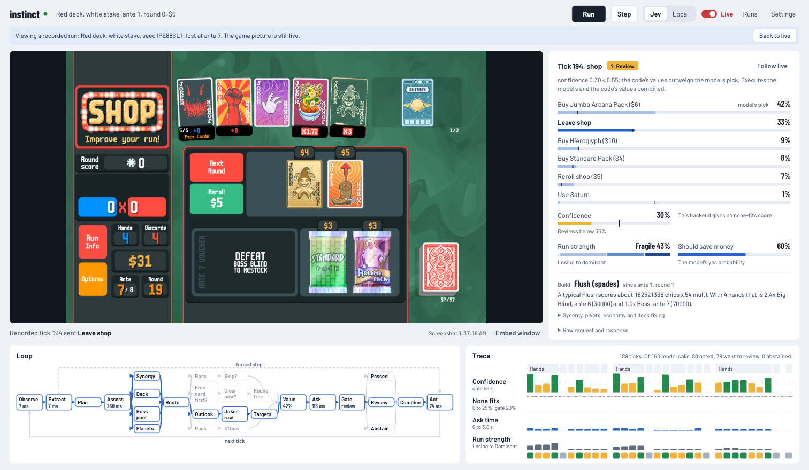
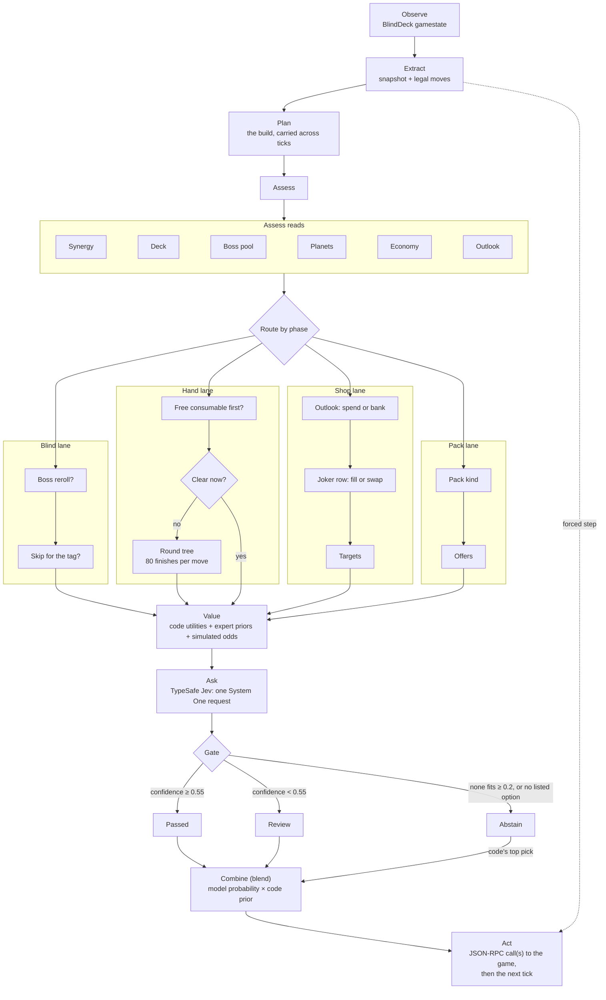
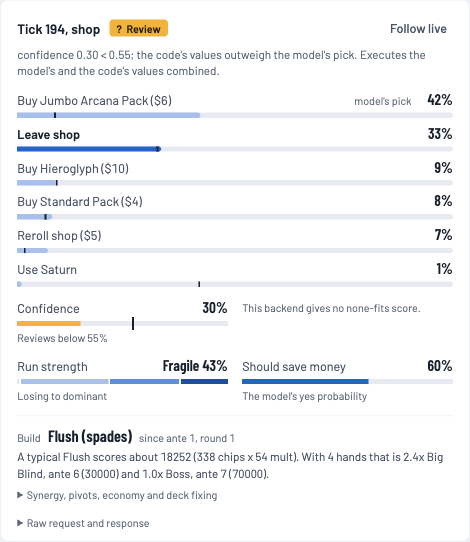
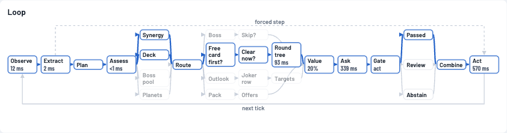
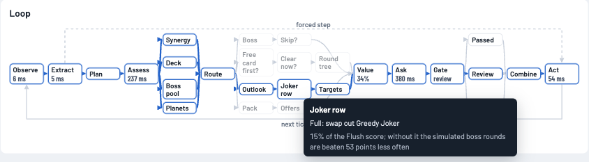

# instinct

**A TypeScript agent that plays Balatro: code works out the odds, a small decision model judges, and gates decide who acts.**




<sub>The dashboard viewing a recorded White-stake run played with cloud Jev. At tick 194 (a shop) the model's top pick, a Jumbo Arcana Pack at 42%, fell under the 55% confidence gate. The code's values outweighed it, and the agent left the shop. The game picture is the live window.</sub>

## Contents

- [How it decides](#how-it-decides)
- [Key ideas](#key-ideas)
- [Results so far](#results-so-far)
- [Quickstart](#quickstart)
- [The dashboard](#the-dashboard)
- [Configuration](#configuration)
- [BlindDeck patches this project relies on](#blinddeck-patches-this-project-relies-on)
- [Project layout](#project-layout)
- [Testing](#testing)
- [Data](#data)
- [Limitations and next steps](#limitations-and-next-steps)

## How it decides

Every game decision is one **tick**. The agent reads the game through the [BlindDeck](https://github.com/FFFishes7/blinddeck) mod's JSON-RPC API, lists the legal moves, and walks a decision tree. The code does the card math and the simulations. The model gets the moves and the facts, and judges which move to make. A forced step (cash out, start a run, a single legal move) skips the model and the gates.



| Stage | What happens | Where |
| - | - | - |
| Observe | `gamestate` over JSON-RPC, re-read until the game settles | `src/loop.ts`, `src/blinddeck.ts` |
| Extract | Normalized snapshot, legal moves (24 at most), exact RPC call per move | `src/extract.ts`, `src/candidates.ts` |
| Plan | The committed build: its main hand, its jokers, the deck it wants. Pivots are gated and locked for the rest of the ante | `src/build.ts`, `src/plan.ts` |
| Assess | Synergy (which jokers carry the score), deck fixes, the coming boss and what a reroll could draw, Planet value, missing jokers, interest, outlook against the next three bosses | `src/assess.ts` |
| Route | One lane per phase. Each fork records the branch it took and why | `src/candidates.ts` |
| Value | A utility per move from the build, the Roffle priors (jokers only) and the simulations, turned into a prior with a softmax | `src/candidates.ts`, `src/expert.ts` |
| Ask | One request: the `action` Choice, plus `position` (Score), a phase `risk` (Noul), and at shops and joker packs a `build` Choice | `src/strategy.ts`, `src/systemone.ts` |
| Gate | `none_probability ≥ 0.2` abstains (as does no pick, or an unknown one); `confidence < 0.55` goes to review | `src/policy.ts` |
| Combine | In `blend` mode: the move with the best `log(p_model) + log(prior)`. When the model abstains, the code's top move | `src/policy.ts` |
| Act | One call, or several for a swap (sell, then buy). Every tick and the raw gamestate go to `runs/*.jsonl` | `src/loop.ts` |

## Key ideas

**Code owns the card math. The model only judges.** Hand detection and scoring are code (`poker.ts`, with 55 vanilla jokers modelled by key). Each move goes to the model as a plain-language description, with its estimated chips when it is a play. The model's answer is a probability per move, and the gates decide whether that answer counts.

**Round simulation for hand play** (`round.ts`). When no play beats the blind now, each candidate play or discard is followed by 80 simulated finishes of the round. The rest of the deck is shuffled, cards are drawn back up to hand size, and a fixed greedy policy plays on: it plays the best hand when that hand beats the blind, keeps pace, or no discard is left, and discards otherwise. A move is worth the share of finishes that beat the blind. Simulations are seeded, so a position always simulates the same way. The rules of The Eye, The Mouth and The Hook play inside the simulation; debuffs and hand counts come from the live state.

**Whole-round odds at the next three bosses** (`roundOdds`). Shop and pack choices compare full simulated rounds (40 per setup and boss) dealt fresh from the deck, with and without the card on offer, at the bosses of this ante and the next two. The same machinery drives the assessment:

- **Outlook:** `ahead`, `on pace`, `behind` or `losing`, from the odds at the next bosses. Behind or losing, the shop spends; on pace or ahead, it banks.
- **Synergy:** the odds with every joker, with none, and without each one. A joker whose removal costs 10 points or more carries the score. One that costs under 2 points and has no lasting role (money, copying, scaling) is dead weight.
- **Boss pool:** the coming boss's simulated threat, set against the average of the bosses a reroll can still draw this cycle.
- **Deck fixes and Planets:** Tarots (Sun, Hanged Man, Death, Justice, ...) applied to a copy of the deck, and one more level for the build's hands.
- **Targets:** the jokers that would add most, ranked by the build's typical hand, then simulated.

**Expert data as priors, not prompt advice.** The Roffle Lite dataset (`data/roffle`) holds 4,599 decisions from 12 recorded runs, extracted locally from the videos. `tools/roffle/priors.ts` counts how often he took each joker when it was offered. `expert.ts` turns that into a smoothed take rate, and its gap from the base rate becomes a small utility nudge (`EXPERT_WEIGHT = 1`). The weight was chosen leave-one-video-out with `tools/roffle/agree.ts` on 173 picks: pick agreement was 46% at weight 0, 50% at 0.5, and 53% at 1, and 1.5 added nothing. The model never sees the expert record. Its state carries the rules of the game as facts (`STRATEGY_GENERAL`, `STRATEGY_BY_PHASE`) and the assessment as facts the code worked out. How to play lives in the values.

**Feature switches** (`src/features.ts`). Each decision stage can be switched off so its effect can be measured in the simulator. All of them are on in play except the two that measured worse:

| Switch | State | Note |
| - | - | - |
| `roundSim` | on | Hand: plays and discards judged by simulated finishes |
| `shopSim` | on | Shop, packs, blind select: the assessment and simulated offers |
| `padding` | on | Small hands fill spare slots with junk kickers that cycle out |
| `skipOutlook` | on | A run behind its bosses values skipping less |
| `deckFixSim` | on | Deck-changing Tarots and Spectrals judged on the changed deck |
| `bossPoolReroll` | on | Reroll a boss when it is worse than the average replacement |
| `packOdds` | on | Packs carry the expected gain of the best card they could show |
| `uselessJoker` | on | A joker that changes nothing in simulation is worth less |
| `targetReroll` | **off** | On, it cost 0.45 antes on average over 30 simulated White games |
| `simSynergy` | **off** | On, the mean ante went from 6.0 to 5.8 and wins from 2 to 1 (30 simulated White games; within noise) |
| `outlookOnly` | **off** | Off, the build estimate can also say "behind", which held up better |

## Results so far

| Where | Setup | Games | Outcome |
| - | - | - | - |
| Built-in simulator | White stake, six decks, the shipped values | 300 | Mean ante reached 6.9, playing on past a win up to ante 16; 83 wins (28%) |
| Built-in simulator | Red to Gold stake, six decks, the values during per-stake tuning | 360 per stake | Mean ante reached: Red 6.0, Green 4.9, Black 4.7, Blue 4.3, Purple 3.7, Orange 3.5, Gold 3.3. Wins fall from 18% at Red to none at Orange and Gold |
| Real game | White stake, six decks, mock model, tuned values (`simWeight` 1.69) | 40 | 14 wins (35%); the values before tuning won 11 on the same seeds |
| Real game | White stake, cloud Jev, first batch | 8 | 2 wins (Red and Blue decks); the other six ended at antes 3 to 6 |

The six decks are Red, Blue, Yellow, Green, Black and Plasma. Simulator games use the mock model, so they measure the code's values, not Jev.

The values in `src/tuning.ts` were measured, not picked. `tools/autotune.ts` moved one number at a time over about 19,000 simulator games. On 300 fixed seeds the values it found beat the old ones by +0.40 ± 0.13 average ante, and its later steps changed little. Raising `simWeight` from 1.69 to 2.2 then gained +0.18 ± 0.12 more on 300 fixed seeds. A night of per-deck and per-stake tuning (73 tests, 120 games per arm) kept 8 changes, about what chance alone gives at its bar, so none of them are shipped and `PROFILES` is empty. Telling per-deck differences this small apart would take several times more games per arm.

## Quickstart

### Requirements

- **macOS.** `tools/instances.sh` uses the Steam and Application Support paths.
- **Node 24.** Node runs the `.ts` files directly (type stripping), so there is no build step and no runtime dependency. `package.json` allows Node 23.6 and up; this was developed on 24.18.
- **For the real game:** Balatro on Steam with [Lovely](https://github.com/ethangreen-dev/lovely-injector), [Steamodded](https://github.com/Steamodded/smods), and the BlindDeck mod (folder name `balatrobot`, v1.5.2) with the [local patches below](#blinddeck-patches-this-project-relies-on). Extra instances also need [HandyBalatro](https://github.com/SleepyG11/HandyBalatro) for its animation skip.
- **A decision model:** a TypeSafe API key in `TYPESAFE_API_KEY` for cloud Jev, or a local [StartLux](https://github.com/StartLuxLabs/StartLux-Decision) server on `:8090`.

### Run it

No game or model is needed for the first three:

```bash
npm test          # 75 tests, about 13 s
npm run mock      # simulator + mock model, fully offline; dashboard at http://127.0.0.1:8765
npm run sim       # simulator + the real model
```

On the real game, with Balatro running and the mod listening on `127.0.0.1:12346`:

```bash
export TYPESAFE_API_KEY=...        # your key; nothing in this repo loads .env for you
npm start -- --backend cloud --live --deck RED --stake WHITE
# open http://127.0.0.1:8765 and press Run
```

Without `--live` the agent runs dry: it decides, shows the decision, sends nothing, and pauses. You can switch Live on in the dashboard. Without `--deck` it waits at the main menu, and the dashboard shows a start form instead.

Keep playing run after run (needs `--deck` and `--live`):

```bash
npm start -- --backend cloud --live --deck RED --stake WHITE --continuous
```

`scripts/play.sh` launches Balatro through Balala with settings meant for watching (60 fps animations, game speed 2). Set `BALALA` if Balala isn't at `~/Desktop/Balala.app`.

### Extra instances and batches

`tools/instances.sh` starts more Balatro processes, each with its own BlindDeck port:

```bash
tools/instances.sh start 3            # ports 12350-12352; the first one has a window
tools/instances.sh start 3 12360 0    # ports 12360-12362, all headless
tools/instances.sh status
tools/instances.sh stop
```

Each instance saves to its own folder (`~/Library/Application Support/BalatroBot-<n>`), seeded with a copy of your profile 2, and plays on profile 2. Your own settings, stats and saves are never touched, and `start` backs them up first anyway. Instances run in fast mode with Handy's animation skip held at "everything". Headless ones also turn shaders off.

`tools/batch.ts` plays a fixed list of seeds, so a change is judged on the same deals. It runs one worker per URL:

```bash
node tools/batch.ts --games 20 --decks RED,BLUE,PLASMA --stake WHITE
node tools/batch.ts --games 6 --urls http://127.0.0.1:12350,http://127.0.0.1:12351,http://127.0.0.1:12352
node tools/batch.ts --games 3 --sim --mock     # plumbing check: simulator, mock model
```

| Flag | Default | Meaning |
| - | - | - |
| `--games` | `10` | Games to play |
| `--decks` | `RED` | Comma-separated decks, assigned round-robin |
| `--stake` | `WHITE` | Stake for every game |
| `--urls` | `http://127.0.0.1:12346` | One BlindDeck URL per worker |
| `--backend` | `cloud` | `local` uses StartLux on `:8090` |
| `--sim`, `--mock` | off | Built-in simulator; mock model |
| `--prefix` | `INST` | Seed prefix; the seed is the prefix plus the game number, so reruns replay the same deals |
| `--max-ticks` | `2500` | Safety stop per game |

Results go to `runs/batch-<time>/results.json`, next to each worker's run log.

<!-- Recording placeholder: docs/media/instances.gif, three instances playing a batch, one with a window. -->
> Recording coming: a three-instance batch (`docs/media/instances.gif`).

### Roffle tools

```bash
node tools/roffle/priors.ts                  # rebuild data/roffle/priors.json
node tools/roffle/agree.ts --weights 0,0.5,1 # leave-one-video-out agreement with his joker picks
node tools/roffle/agree.ts --margin 0.5      # same, at another swap margin
node tools/roffle/style.ts --json            # how he plays hands -> data/roffle/style.json
```

`agree.ts` also takes `--misses`, `--takes`, `--sells`, `--start-deck`, `--level-one`, `--videos id,id` and `--debug VIDEO:SECOND`. It measures the code's utilities, not the model. Rebuilding the dataset itself (Python, yt-dlp, a vendored detector) is covered in [`data/roffle/README.md`](data/roffle/README.md).

## The dashboard

The page is plain TypeScript, served with the types stripped on the fly, and the whole UI is drawn at 90% CSS zoom. Events stream over SSE.

<p>
  
</p>

- **Top bar:** Run and Step, the model switch (Jev or Local), the Live switch (dry run or live), **Runs** (view a recorded run, or replay it on the game from its seed), and **Settings** (what to do when the gates fail, and the delay between ticks).
- **Game:** the real game window. BlindDeck screenshots refresh every 300 ms with the async screenshot patch; without it they refresh only while the agent is paused. **Embed window** captures the Balatro window in the browser instead (`getDisplayMedia`) for a live, full-frame-rate view.
- **Decision:** the tick and its verdict (Act, Review, Abstain, Auto), the reason, and one bar per legal move. Each bar shows the model's probability, the code's prior as a tick mark, and labels for the model's pick and the move sent. Below are the confidence and none-fits gate meters, the model's run-strength score and the phase's yes/no question, and the build plan (strength, needs, commitment, synergy, dead weight, pivot options, economy, deck fixing). The raw request and response are one click away. While the agent is paused, you can click a move to send it.

<br clear="right">

- **Loop:** the decision tree from the diagram above. The path the shown tick took is drawn in blue. Each fork shows the branch it took, each stage shows its time, and you can hover any node for why.
- **Trace:** one column per tick, with lanes for confidence (gate line at 55%), none fits (gate at 20%), ask time and run strength, and the game phase across the top. Click a column to pin that tick everywhere. **Follow live** unpins it.





<!-- Recording placeholder: docs/media/embed.gif, switching from screenshots to Embed window during a live run. -->
> Recording coming: the Embed window live view (`docs/media/embed.gif`).

## Configuration

Settings come from the environment and from flags (`src/config.ts`). Flags win where both exist. Nothing reads `.env` automatically. Export the variables, or run `node --env-file=.env src/server.ts`. `.env.example` is a template set up for the local backend.

| Flag | Env var | Default | Meaning |
| - | - | - | - |
| | `TYPESAFE_API_KEY` | | Key for cloud Jev. The value `local` counts as no key |
| | `TYPESAFE_BASE_URL` | `https://api.typesafe.ai` | Cloud endpoint. A `localhost` URL instead selects the local backend and becomes its URL |
| `--backend cloud\|local` | | from `TYPESAFE_BASE_URL` | Starting backend; switchable in the dashboard |
| | `CLOUD_MODEL` | `jev-latest` | Model name for cloud requests |
| | `LOCAL_DECISION_URL` | `http://localhost:8090` | Local StartLux server |
| | `LOCAL_MODEL` | `StartLux-Decision-v1.1-4B-Instant` | Model name for local requests |
| | `DECISION_MODEL`, `TYPESAFE_DEFAULT_MODEL` | | Model for whichever backend `TYPESAFE_BASE_URL` points at |
| | `BALATRO_API_URL` | `http://127.0.0.1:12346` | BlindDeck endpoint |
| `--live` | | off (dry run) | Send actions from the start |
| `--deck` | `BALATRO_DECK` | | Start runs from the menu with this deck |
| `--stake` | `BALATRO_STAKE` | `WHITE` | Stake for auto-started runs |
| `--seed` | `BALATRO_SEED` | random | Seed for auto-started runs |
| `--continuous` | | off | After game over, start the next run (needs `--deck` and `--live`) |
| `--endless` | | off | Continue into endless mode after a win |
| `--review` | `REVIEW_MODE` | `blend` | `blend`, `fallback`, `model` or `pause` (below) |
| | `MIN_CONFIDENCE` | `0.55` | Below this the answer goes to review |
| | `NONE_THRESHOLD` | `0.2` | At or above this the model abstains |
| `--delay` | `TICK_DELAY_MS` | `600` | Pause between ticks, in ms |
| | `SCREEN_INTERVAL_MS` | `2000` | Screenshot interval while paused (stock BlindDeck) |
| `--no-screen` | | screenshots on | No BlindDeck screenshots |
| `--no-expert` | | expert priors on | Ignore `data/roffle/priors.json` |
| `--port` | `INSTINCT_PORT` | `8765` | Dashboard port |
| `--sim` | | | Built-in simulator; also turns on live, turns off screenshots, auto-starts RED on WHITE |
| `--mock-model` | | | Offline mock model (probabilities from the code's priors, jittered) |

| Review mode | When the gates fail |
| - | - |
| `blend` (default) | Every answered tick takes the move with the best model probability × code prior. Abstentions take the code's top move |
| `fallback` | Take the code's top move |
| `model` | Trust the model's pick anyway |
| `pause` | Wait for a human to click a move |

Cloud Jev returns no `none_probability`, so on cloud the 20% abstain gate never fires. A cloud abstention happens only when the model picks no option or an unknown one.

## BlindDeck patches this project relies on

These changes live in the local BlindDeck checkout (`~/Library/Application Support/Balatro/Mods/balatrobot`), not in this repo. The agent still works without each one, as noted.

| Patch | Mod file | What it does | Without it |
| - | - | - | - |
| Draw pile and whole deck, sorted | `src/lua/utils/gamestate.lua` | The draw pile (`cards`) is no longer masked, since the in-game deck view shows it; it is sorted by key so the order stays hidden. Adds `full_deck` with every playing card, wherever it is | The agent assumes the starting deck minus the hand and marks the deck as assumed |
| `bosses_used` | `src/lua/utils/gamestate.lua` | Bosses drawn this run, key to count, which tells the boss pool what a reroll can draw | The agent counts the bosses it has seen |
| Async screenshots | `src/lua/endpoints/screenshot.lua` | `screenshot` with `async: true` encodes the PNG on a background thread (temp file, then rename) | Each screenshot stalls the game for about 0.2 s, so screenshots run only while paused |
| `BALATROBOT_IDENTITY`, `BALATROBOT_PROFILE` | `src/lua/settings.lua` | Moves the instance's saves to their own folder in Application Support and loads a profile slot from it. The profile applies only when the identity is set | Used by `tools/instances.sh` only |
| `BALATROBOT_ANIMATION_SKIP` | `balatrobot.lua` | Holds Handy's animation skip at a level (1 none, 2 messages, 3 animations, 4 everything) every frame | Used by `tools/instances.sh` only |

Stock BlindDeck settings used here: `BALATROBOT_PORT` (default 12346), `BALATROBOT_HEADLESS`, `BALATROBOT_FAST` (uncapped FPS, 10x game speed, 60 fps animations), `BALATROBOT_NO_SHADERS`, and, in `scripts/play.sh`, `BALATROBOT_GAMESPEED`, `BALATROBOT_ANIMATION_FPS` and `BALATROBOT_NO_REDUCED_MOTION`.

## Project layout

```text
instinct/
├── src/
│   ├── server.ts        dashboard server: UI with types stripped, SSE events, control API
│   ├── loop.ts          the agent loop; logs every tick and raw gamestate to runs/*.jsonl
│   ├── config.ts        flags and env vars
│   ├── blinddeck.ts     JSON-RPC client for the mod (serialized calls)
│   ├── types.ts         BlindDeck GameState shapes (OpenRPC v1.5.2)
│   ├── extract.ts       gamestate -> snapshot + compact model state
│   ├── cards.ts         card shapes shared by everything
│   ├── poker.ts         hand detection + joker-aware score estimate
│   ├── options.ts       play/discard options from rank and suit groups (linear in hand size)
│   ├── knowledge.ts     static game knowledge: joker tags, Tarots, decks, stakes, blinds, boss pool
│   ├── build.ts         build profile: archetype, power, economy, deck needs
│   ├── plan.ts          the committed build and the pivot rules
│   ├── assess.ts        synergy, boss, boss pool, deck, Planets, targets, economy, outlook
│   ├── round.ts         round simulation: per-move finishes and whole-round odds
│   ├── parallel.ts      round simulations spread over worker threads (simworker.ts), same results
│   ├── growth.ts        jokers that grow or run down from round to round
│   ├── synergy.ts       what jokers do for each other, and what feeds them
│   ├── direction.ts     the run's direction: the cards worth looking for
│   ├── deckfix.ts       Tarot/Spectral effects applied to a copy of the deck
│   ├── candidates.ts    legal moves per phase, the tree's forks, utilities, RPC calls
│   ├── expert.ts        Roffle priors -> per-joker nudges
│   ├── features.ts      switches for the decision stages
│   ├── tuning.ts        the measured numbers the stages weigh, and per-deck/per-stake PROFILES
│   ├── strategy.ts      the System One request: rules as facts, questions per phase
│   ├── systemone.ts     HTTP engine (Jev or StartLux) + offline mock
│   ├── policy.ts        gates and review modes
│   ├── runs.ts          recorded runs: list, view, replay from seed
│   ├── sim.ts           in-process Balatro stand-in that speaks BlindDeck's methods
│   └── sim/             the simulated vanilla game: run state, game loop, jokers, consumables, data
├── ui/                  dashboard: app.ts, flow.ts (loop), trace.ts, charts.ts, dom.ts
├── test/                node:test suites
├── tools/
│   ├── batch.ts         fixed-seed batches on one or more instances
│   ├── instances.sh     extra Balatro instances on their own ports
│   ├── simbench.ts      seeded simulator games, one JSON line per game
│   ├── tune.ts          paired arms on the same seeds: the difference and its standard error
│   ├── autotune.ts      one-number-at-a-time search of src/tuning.ts, resumable
│   ├── fidelity.py      how close the simulator is to the real game, from run logs
│   ├── textures.py      the game's sprites for the dashboard, from your Balatro.love (kept local)
│   ├── bu/              Balatro University claims pipeline (Python)
│   └── roffle/          dataset pipeline (Python) and priors/agree/style tools (TS)
├── data/roffle/         Roffle Lite dataset, priors.json, style.json, joker catalog
├── data/bu/             Balatro University claims, tier lists and caption words
├── scripts/play.sh      launch Balatro via Balala with watch-friendly settings
├── docs/media/          README images
├── balatro_controller.py   the first prototype: one Python tick, dry run
└── HANDOFF.md           session notes
```

## Testing

```bash
npm test             # node:test over test/*.test.ts: 128 tests, no game or model needed
npm install          # dev only: typescript + @types/node
npm run typecheck    # tsc --noEmit over src, ui, test, tools
```

The suites cover hand detection and scoring, candidate lists, consumables, the decision tree's forks, the gates and review modes, the plan and its pivots, the expert priors, the round simulation, and a full loop against the simulator with the mock model. Some tests turn a feature switch off and check that the decision changes.

## Data

`data/roffle/` holds the Roffle Lite decisions dataset: 12 runs, 4,599 decisions, with what each shop or pack offered, what he held, where his cursor rested, and what he said. It was extracted locally from the videos and their auto-captions, with no model API. Ten runs are at Gold stake and two are endless runs at White.

| Versioned | Kept local (`.gitignore`) |
| - | - |
| `videos.json`, `decisions.jsonl`, per-video `<id>.json` and `<id>.decisions.jsonl` | Downloaded videos and captions (`data/roffle/videos/`) |
| `priors.json` (read by the agent), `style.json`, `playbook.json`/`.md` | Scratch frames (`data/roffle/tmp/`) |
| `catalog/*.json` (jokers, consumables, blinds, tags from the game files) | Sprite crops (`catalog/sprites/`) |
| | Third-party detector and Python packages (`tools/roffle/vendor/`, `.vendor/`) |

`data/bu/` holds what Balatro University says to do in 19 of his videos: 176 claims with timestamped caption quotes, and his tier lists for all 150 jokers, 52 consumables and the tags (`tiers.json`, whose priors the agent reads). It was read without any model API, and every quote is checked by script against the captions; see `data/bu/README.md`.

Run logs (`runs/`), local model weights (`models/`, `StartLux-Decision/`) and instance state (`.instances/`) are also kept out of git.

## Limitations and next steps

- **The simulator is close, not exact.** It deals the vanilla game (144 jokers, every pack, Tarot, Planet, Spectral, voucher, boss, tag, sticker and deck), but it lacks Hiker's card chips, and Lucky Cards and Bloodstone score at their expected value. Its games use the mock model, so the real game (`tools/batch.ts`) stays the judge.
- **Unmodelled jokers count as their live stats only.** Jokers outside the 55 modelled by key (most vanilla jokers, and modded ones such as Cryptid's) apply their live `value.stats` unconditionally, and the estimate is flagged approximate. Inside a simulation, jokers keep their current values for the whole round.
- **Boss rules are partly modelled.** Suit and face debuffs, The Flint, The Needle, The Water, The Manacle, The Eye, The Mouth, The Hook, The Psychic and The Serpent change the simulated rounds. Other bosses play as plain blinds.
- **The greedy continuation ranks moves; it doesn't predict scores.** Hands larger than 12 cards skip the round tree and fall back to one-hand values.
- **Jev latency is now the main speed limit.** Every decision that isn't forced waits for an answer, which takes a few hundred milliseconds (339 ms and 380 ms on the two ticks in the loop screenshots above).
- **Shop confidence is low.** Jev's shop answers often fall below the 55% gate, so the blend of model and code values decides there.

Open directions, if the project is picked up again: a study of where runs are lost (which antes and bosses); scoring runs on [evalatro](https://github.com/alesha-pro/evalatro); and per-deck tuning with enough games per arm to resolve small differences.

## Acknowledgments

[BlindDeck](https://github.com/FFFishes7/blinddeck) and [balatrobot](https://github.com/coder/balatrobot) for the game API; Lovely, Steamodded and HandyBalatro; [TypeSafe](https://docs.typesafe.ai) for Jev and System One; [StartLux](https://github.com/StartLuxLabs/StartLux-Decision) for the local model; Roffle Lite for the runs the dataset was read from; [BalatroEngine](https://github.com/manwhar/BalatroEngine) for the card detector (used locally, not redistributed).

Balatro is by LocalThunk and published by Playstack. This project is not affiliated with either.
